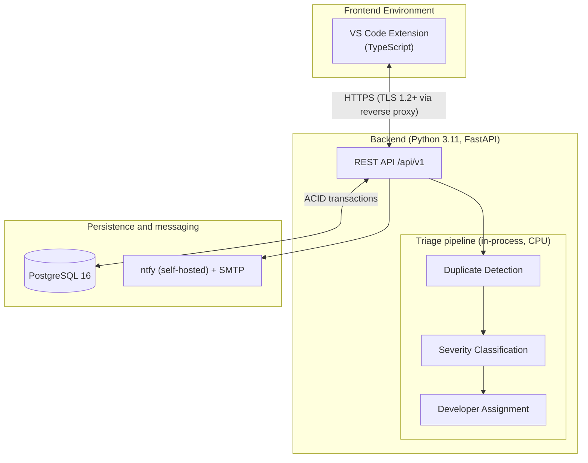
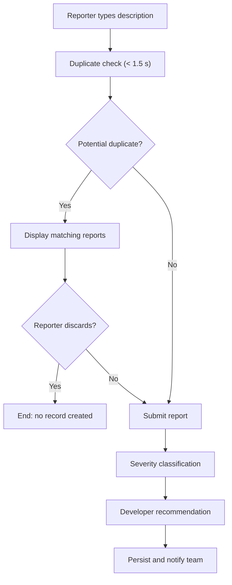
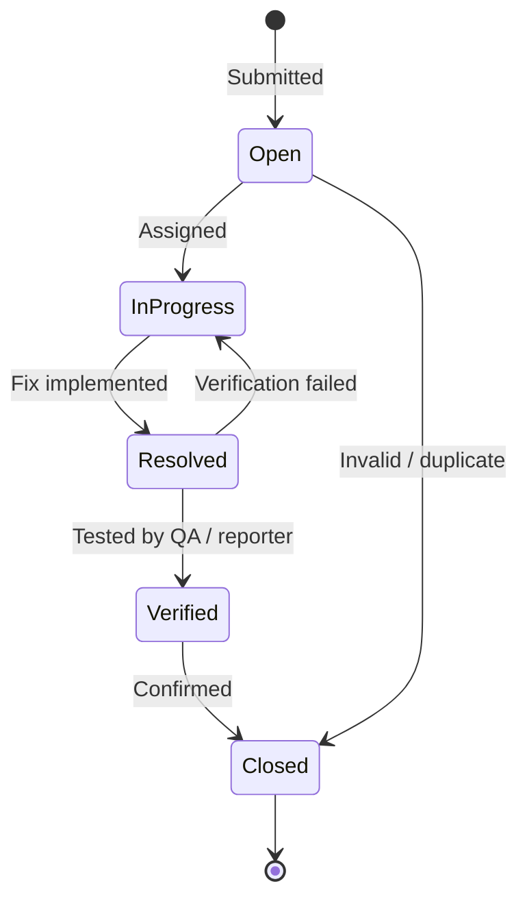

# AI-Powered Bug Tracking System

[](#project-status)
[](#architecture)
[](#technology-stack)
[](#quality-attributes)
[](#license)

A Visual Studio Code extension that automates bug triage by combining real-time duplicate detection, severity classification, and developer assignment into a single AI pipeline.

Developed as a Software Engineering capstone project at the College of Engineering, Al Ain University, UAE.

---

## Table of Contents

- [Background](#background)
- [Key Features](#key-features)
- [Architecture](#architecture)
- [Triage Pipeline](#triage-pipeline)
- [AI Components](#ai-components)
- [Bug Lifecycle](#bug-lifecycle)
- [Technology Stack](#technology-stack)
- [Requirements](#requirements)
- [Quality Attributes](#quality-attributes)
- [Datasets and Evaluation](#datasets-and-evaluation)
- [Repository Structure](#repository-structure)
- [Getting Started](#getting-started)
- [Project Status](#project-status)
- [Standards and Compliance](#standards-and-compliance)
- [Scope](#scope)
- [Team](#team)
- [Acknowledgements](#acknowledgements)
- [References](#references)
- [License](#license)

---

## Background

Bug triage requires three decisions for every incoming report:

1. Is it a duplicate of an existing report?
2. How severe is it?
3. Which developer should resolve it?

In most organizations these decisions are made manually, which does not scale. In five widely used open-source bug datasets, about 15–19% of reports are duplicates (Meng et al., 2024), and misassigned reports are frequently reassigned multiple times before resolution (bug tossing).

Prior research has addressed each task individually, validated offline on historical data. This project integrates all three into a deployable system with shared state between modules, real-time latency constraints, and the application infrastructure required for production use.

---

## Key Features

- **Real-time duplicate detection** while the reporter is typing, before the report is stored
- **Automatic severity classification** into Low, Medium, High, and Critical
- **Developer assignment recommendations** ranked by historical resolution data, with **cold-start handling** for new developers
- **Shared-state triage pipeline**: a likely duplicate boosts the original's fixer; a Critical bug skips busy developers
- **Full bug lifecycle management** with status workflow and audit trail
- **Role-based access control** for Reporters, Developers, Project Managers, and Administrators
- **Administration**: developer profiles, developer tracking, runtime AI thresholds
- **Project dashboards** with bug trends and resolution-time metrics
- **Email and in-app notifications** for assignment, status, and critical-severity events
- **Graceful degradation** when the AI service is unavailable

---

## Architecture



**Design rationale**

| Decision | Reason |
|:--|:--|
| Frontend as a VS Code extension | Removes context switching; no additional tooling for teams |
| AI inference on the backend | The VS Code runtime cannot host heavy model inference; models run in the backend process on CPU |
| Stateless backend | Enables horizontal scaling behind a load balancer |
| Relational database | ACID guarantees for bug records, audit logs, and user data |
| Minimal data transmission | Only report text and metadata are sent; source code is never uploaded |

---

## Triage Pipeline



Outputs of earlier stages (duplicate status, severity) are passed as inputs to later stages, so the modules share state rather than operating independently (`ml/service/context.py`, `TriageContext`). Each stage has its own time budget; a failed or slow stage is marked degraded and the report is still saved, as `Unclassified` if no severity is available.

Detailed diagrams (use case, architecture, deployment, class, ERD, sequence, state, activity) are in [`docs/diagrams/`](docs/diagrams/).

---

## AI Components

| Component | Approach | Output | Target |
|:--|:--|:--|:--|
| Duplicate Detection | Two-phase: BM25 retrieval followed by semantic similarity re-ranking | Up to 3 candidate matches with similarity score | Recall@5 > 80% |
| Severity Classification | TF-IDF features with SVM / Random Forest / Naive Bayes voting ensemble | Low, Medium, High, Critical | Accuracy ≥ 85% |
| Developer Assignment | CNN-LSTM trained on historical assignment data, blended with profile matching for cold start: score = α·history + (1−α)·profile, α = min(1, resolved/N) | Top 3 ranked developers with a reason | ≥ 20% reduction in reassignments vs. random baseline |

**Model selection.** Lightweight, CPU-friendly models were chosen over transformer and LLM alternatives. The literature review found the accuracy difference (roughly 5–10 points) does not justify GPU infrastructure for a system with sub-second latency requirements.

**Human oversight.** Developers and Project Managers can override severity. Project Managers make the final assignment decision. All overrides are recorded in the audit trail.

---

## Bug Lifecycle



Each transition is restricted to authorized roles and logged with timestamp and actor.

---

## Technology Stack

| Layer | Technology |
|:--|:--|
| Client | VS Code Extension API, TypeScript |
| Backend | Python 3.11, FastAPI, Pydantic v2, SQLAlchemy 2, Alembic |
| Machine Learning | scikit-learn (TF-IDF, SVM, RF, NB), BM25, sentence-transformers (`all-MiniLM-L6-v2`, local), PyTorch CNN-LSTM (CPU) |
| Notifications | Self-hosted ntfy, SMTP (Mailpit in development), VS Code notifications |
| Infrastructure | Docker Compose, GitHub Actions, CodeRabbit, Snyk |
| Database | PostgreSQL 16 |
| API Specification | OpenAPI 3.0.3 ([`docs/openapi.json`](docs/openapi.json)) |

---

## Requirements

The specification defines **22 functional requirements**, **14 non-functional requirements**, and **5 design constraints**. Each one is traced to code, tests and status in [`docs/traceability.md`](docs/traceability.md).

<details>
<summary><strong>Functional requirements (FR-01 – FR-22)</strong></summary>

| ID | Requirement | Area | Priority |
|:--|:--|:--|:--|
| FR-01 | Registration | User Management | High |
| FR-02 | Authentication | User Management | High |
| FR-03 | Role-Based Access Control | User Management | High |
| FR-04 | Profile Management | User Management | Medium |
| FR-05 | Bug Submission Form | Bug Lifecycle | High |
| FR-06 | Bug Status Lifecycle | Bug Lifecycle | High |
| FR-07 | Search and Filtering | Bug Lifecycle | High |
| FR-08 | Audit Trail | Bug Lifecycle | High |
| FR-09 | Comments | Bug Lifecycle | Medium |
| FR-10 | Real-Time Duplicate Detection | AI Features | High |
| FR-11 | Automatic Severity Classification | AI Features | High |
| FR-12 | Developer Assignment Recommendations | AI Features | High |
| FR-13 | Persistent Storage | Data Storage | High |
| FR-14 | Attachment Management | Data Storage | Medium |
| FR-15 | Project Dashboard | Data Storage | Medium |
| FR-16 | Email Notifications | Notifications | Medium |
| FR-17 | In-App Alerts | Notifications | Medium |
| FR-18 | Project Management | Administration | High |
| FR-19 | Team Membership | Administration | High |
| FR-20 | Admin-Managed Developer Profiles | Administration | High |
| FR-21 | Developer Tracking | Administration | Medium |
| FR-22 | Cold-Start Handling | AI Features | High |

</details>

<details>
<summary><strong>Design constraints (DC-01 – DC-05)</strong></summary>

| ID | Constraint | Technology / Standard |
|:--|:--|:--|
| DC-01 | VS Code Extension API compliance | TypeScript / JavaScript |
| DC-02 | AI inference offloaded to the backend | FastAPI, REST |
| DC-03 | No source code transmitted externally | GDPR, UAE data protection law |
| DC-04 | Relational database with ACID transactions | PostgreSQL 16 |
| DC-05 | REST API documented before acceptance testing | OpenAPI 3.0 |

</details>

---

## Quality Attributes

| ID | Attribute | Requirement |
|:--|:--|:--|
| NFR-01 | Performance | Page load ≤ 2 s at 100 concurrent users |
| NFR-02 | Performance | Duplicate detection and severity ≤ 1.5 s; assignment ≤ 3 s |
| NFR-03 | Performance | 50 concurrent submissions with < 10% latency degradation |
| NFR-04 | Security | Passwords stored as salted bcrypt hashes |
| NFR-05 | Security | TLS 1.2+ for all client-server traffic |
| NFR-06 | Security | Authorization enforced at the API layer (HTTP 403) |
| NFR-07 | Security | Server-side validation against SQLi, XSS, path traversal |
| NFR-08 | Scalability | Stateless backend with connection pooling |
| NFR-09 | Reliability | Health endpoint and automatic restart (towards 99% availability during business hours) |
| NFR-10 | Reliability | Submissions succeed when AI service is down (severity: Unclassified) |
| NFR-11 | Usability | First bug report within 5 minutes of registration |
| NFR-12 | Accessibility | WCAG 2.1 Level AA |
| NFR-13 | Maintainability | ≥ 70% backend test coverage; full OpenAPI 3.0 spec |
| NFR-14 | Maintainability | Thresholds configurable without redeployment |

---

## Datasets and Evaluation

**Datasets** (public, documented in [`ml/data/README.md`](ml/data/README.md))

| Dataset | Size used | Purpose |
|:--|:--|:--|
| Eclipse Bugzilla (Lamkanfi et al., MSR 2013, joined with logpai/bugrepo text) | 121,908 reports | Severity, assignment |
| Mozilla Bugzilla (same sources) | 326,245 reports (most recent 80,000 fixed bugs for assignment) | Assignment generalisation |
| Eclipse Platform / JDT duplicates (logpai/bugrepo, the data used by Meng et al. 2024) | 85,156 / 45,296 reports | Duplicate detection |

All splits are time-based (train on older reports, test on newer ones); settings were tuned on training/validation data only.

**Results** (every number from a script; full table and analysis in [`docs/results/RESULTS.md`](docs/results/RESULTS.md))

| Target | Achieved | |
|:--|:--|:--|
| Duplicate Recall@5 > 80% | 52.9% (Platform), 55.4% (JDT) searching all earlier reports | Not met |
| Severity accuracy ≥ 85% | 75.8% (majority baseline 76.3%) | Not met |
| ≥ 20% fewer reassignments than random | −88.9% (Eclipse), −77.2% (Mozilla) | Met |
| Duplicates + severity ≤ 1.5 s; assignment ≤ 3 s | 160 ms / 145 ms at p95 over HTTP, 50,000 indexed reports | Met |
| Lists and search ≤ 2 s at 100 concurrent users | 103 ms worst p95, 0 errors | Met |
| 50 concurrent submissions, < 10% slower | +20% p50, +40% p95 | Not met |
| Backend test coverage ≥ 70% | 95.35% (171 tests, [`coverage_backend.txt`](docs/results/coverage_backend.txt)) | Met |

A usability study (n = 5) is planned and has not been run yet.

---

## Repository Structure

```
.
├── backend/            # FastAPI service (Python 3.11): api/, core/, models/, schemas/, services/
│   ├── alembic/        # database migrations
│   ├── scripts/        # seed, OpenAPI export, load tests
│   └── tests/
├── ml/                 # duplicate/, severity/, assignment/, common/, service/ (inference layer)
├── extension/          # VS Code extension (TypeScript, strict)
├── docs/               # decisions/, diagrams/, results/, sprints/, report/
├── .github/workflows/  # CI (lint, type check, tests) and Snyk security scan
├── docker-compose.yml  # postgres, self-hosted ntfy, mailpit, backend
├── Makefile            # `make help` lists all developer commands
└── .env.example        # copy to .env (never commit .env)
```

---

## Getting Started

**Prerequisites:** Docker Engine with Compose v2 (Docker Desktop, OrbStack or Colima),
Python 3.11, Node.js 22, VS Code 1.100+, GNU Make.

```bash
git clone https://github.com/yasersafar/AI-Powered-Bug-Tracking-System.git
cd AI-Powered-Bug-Tracking-System
make install   # backend/.venv (backend, ML runtime, dev tools) and extension packages
make up        # creates .env with generated secrets; starts postgres, ntfy, mailpit, backend
make seed      # demo data: 8 accounts (password = SEED_PASSWORD in .env), 2 projects, 50 bugs

# AI models (once, about an hour on a laptop CPU); without them bugs are saved as Unclassified
make install-ml data model-download train

make package-extension   # extension/ai-bug-tracker-0.2.0.vsix, install it in VS Code
make test                # backend + ML tests;  make test-extension: extension tests in VS Code
make lint                # ruff, mypy, eslint, tsc, prettier
make eval                # model evaluation -> docs/results/
make bench               # latency and load tests -> docs/results/
```

Guides: [user guide](docs/user-guide.md) (install, first bug in under 5 minutes, admin
guide, TLS), [demo script](docs/demo-script.md), [traceability](docs/traceability.md),
decisions in [`docs/decisions/`](docs/decisions/) (including
[deviations from the original plan](docs/decisions/deviations.md)).

| Service | URL |
|:--|:--|
| API docs (Swagger UI) | http://localhost:8000/docs |
| Health check | http://localhost:8000/health |
| ntfy (self-hosted push) | http://localhost:8080 |
| Mailpit (dev inbox) | http://localhost:8025 |

To develop the extension, open `extension/` in VS Code and press **F5**.

---

## Project Status

The project follows an Agile process with one- to two-week sprints across two semesters.

| Phase | Period | Status |
|:--|:--|:--|
| Domain study and literature review | Jan – Mar 2026 | Complete |
| Requirements specification | Apr 2026 | Complete |
| Capstone I presentation | May 2026 | Complete |
| System design and architecture | Sep 2026 | Complete |
| Implementation and AI integration | Oct – Nov 2026 | Complete |
| Testing and validation | Nov – Dec 2026 | Automated tests and benchmarks complete; usability study pending |
| Final documentation and presentation | Dec 2026 | Planned |

---

## Standards and Compliance

| Standard | Application |
|:--|:--|
| IEEE 830 | Software requirements specification |
| IEEE 1220 | Systems engineering process |
| ISO/IEC 12207 | Software lifecycle processes |
| WCAG 2.1 Level AA | Accessibility |
| GDPR, UAE Data Protection Law | Handling of personal data and report content |

---

## Scope

**In scope:** bug reporting, triage, tracking, and analysis within the IDE.

**Out of scope:**

- Replacing GitHub or GitLab as a project management platform
- Automated code generation or bug fixing

---

## Team

| Name | Role |
|:--|:--|
| Yaser Safar | Developer |
| Mohammed Naser AlOthmanli | Developer |
| Mohammed Abdullatif Saleh | Developer |
| Mohammed Jamal Abu Safat | Developer |

**Supervisor:** Dr. Noor Aldeen Alawad

---

## Acknowledgements

We thank Dr. Saqib Iqbal, Dr. Issam Al Azzoni, Prof. Zina Houhamdi, Dr. Musab Hijazi and Dr. Ayman Odeh, and the College of Engineering at Al Ain University for their guidance and support.

---

## References

Selected sources. The complete bibliography (20 works) is available in the project report.

1. N. Adhikari, R. Bista, and J. C. Ferreira, "Leveraging machine learning for enhanced bug triaging in open-source software projects," *IEEE Access*, vol. 13, pp. 136237–136254, 2025.
2. R. Bocu, A. Baicoianu, and A. Kerestely, "An extended survey concerning the significance of artificial intelligence and machine learning techniques for bug triage and management," *IEEE Access*, vol. 11, pp. 123924–123937, 2023.
3. S. Mani, A. Sankaran, and R. Aralikatte, "DeepTriage: Exploring the effectiveness of deep learning for bug triaging," arXiv:1801.01275, 2018.
4. Q. Meng, X. Zhang, G. Ramackers, and J. Visser, "Combining retrieval and classification: Balancing efficiency and accuracy in duplicate bug report detection," arXiv:2404.14877, 2024.
5. M. Namdar, F. Barzinpour, R. Noorossana, and M. Saidi-Mehrabad, "Automated software bug severity classification using ensemble machine learning scheme: A real case study," *PLOS ONE*, vol. 20, no. 10, 2025.
6. I. Pikh et al., "Detecting duplicates in bug tracking systems with artificial intelligence: A combined retrieval and classification approach," *Applied Sciences*, vol. 16, no. 1, Art. no. 416, 2026.
7. U. B. Torun, M. T. Demircan, M. F. Gön, and E. Tüzyün, "Past, present, and future of bug tracking in the generative AI era," arXiv:2510.08005, 2025.

---

## License

Copyright © 2026 Yaser Safar, Mohammed Naser AlOthmanli, Mohammed Abdullatif Saleh, Mohammed Jamal Abu Safat.

All rights reserved. This work is subject to the Intellectual Property Policy of Al Ain University. Use of any material from this repository requires appropriate acknowledgement.
