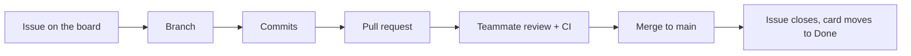

# Sprint Records

The team follows Scrum-style Agile with **2-week sprints**. Each sprint has one file here.

| Sprint | Dates | Goal | File |
|:--|:--|:--|:--|
| Sprint 1 | 11 Sep – 24 Sep 2026 | Set up the repository and turn jury comments into issues | [sprint-01.md](sprint-01.md) |
| Sprint 2 | 25 Sep – 08 Oct 2026 | Protect `main` and plan the backend | [sprint-02.md](sprint-02.md) |
| Sprint 3 | 09 Oct – 22 Oct 2026 | Submit a bug from VS Code and get a severity label | [sprint-03.md](sprint-03.md) |
| Sprint 4 | 23 Oct – 05 Nov 2026 | _Planned at the end of Sprint 3_ | |
| Sprint 5 | 06 Nov – 19 Nov 2026 | _Planned_ | |
| Sprint 6 | 20 Nov – 03 Dec 2026 | _Planned_ | |

## How we work

- **1 issue = 1 branch = 1 pull request**, reviewed by another member (`main` is protected).
- Board columns: `Backlog → Ready → In progress → In review → Done`.
- Every sprint contains both **jury-feedback** tasks and **coding** tasks.

## Ceremonies

| Ceremony | When | Output |
|:--|:--|:--|
| Sprint planning | First day of the sprint | "Planning" table in the sprint file |
| Stand-up | Twice a week (short message in the team chat) | "Stand-up notes" table |
| Sprint review | Last day, with the supervisor when possible | "Review" section |
| Retrospective | Last day | "Retrospective" section |

## Roles

| Member | GitHub | Role |
|:--|:--|:--|
| Yaser Safar | `yasersafar` | Team lead, integration, CI |
| Mohammed Abdullatif Saleh | `MohammedAfSaleh` | Backend (FastAPI + PostgreSQL) |
| Mohammed Naser AlOthmanli | `TheWastedArab` | VS Code extension |
| Mohammed Jamal Abu Safat | `Mj-Raid` | Machine learning |
