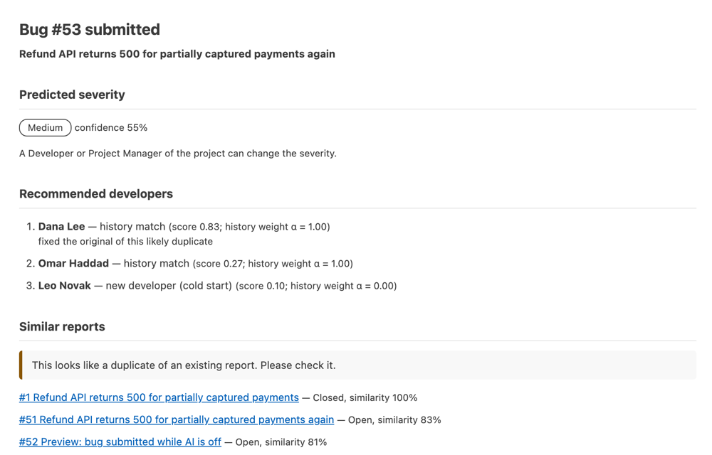
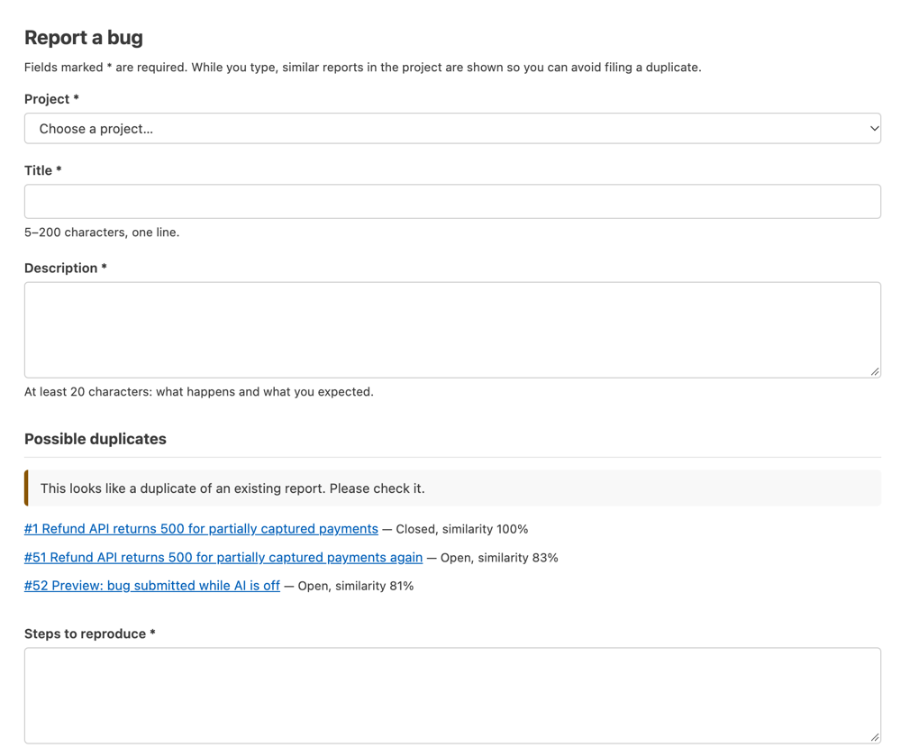
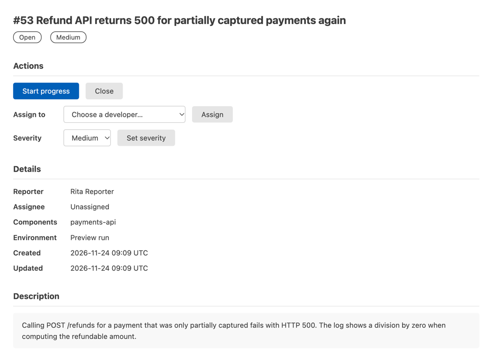
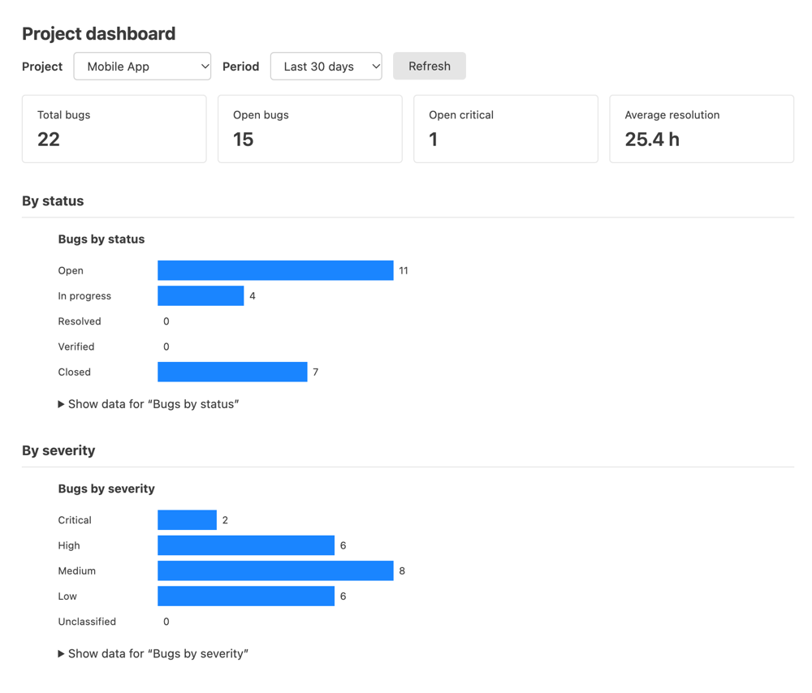

# AI-Powered Bug Tracker

**Report, triage and track bugs without leaving VS Code.** While you type a report, the
extension shows possible duplicates. When you submit, the server predicts the severity and
recommends three developers, each with a reason.

Capstone II project, College of Engineering, Al Ain University.



## Highlights

* **Duplicates while you type** – similar reports in the same project appear with a similarity
  score before anything is saved, so a duplicate never enters the database.
* **Automatic severity** – every new report gets a predicted severity (Critical, High, Medium,
  Low) with a confidence; Developers and Project Managers can change it.
* **Three recommended developers** – based on who fixed similar bugs and on developer
  profiles, with a reason for each; new developers get a fair chance (cold start).
* **Everything in one place** – bug pages with comments, attachments and full history, search,
  a project dashboard, notifications in VS Code, by e-mail and as push messages.
* **Private by design** – reports go only to your team's own server; no source code is sent.
* **Accessible** – keyboard friendly, follows your VS Code theme (light, dark, high contrast).

## Getting started

1. Make sure the Bug Tracker server is running (ask your team, or run `make up` in the
   project folder). The default address is `http://localhost:8000`.
2. Click the **Bug Tracker** icon (a bug) in the left bar, then **Log In** or **Create Account**.
3. Use the **Actions** list at the top of the panel: **Report Bug**, **Search Bugs**,
   **Open Dashboard**, **My Profile and Notifications**, and more.

You can also click your name in the status bar for the same actions. If your server has a
different address, run **Bug Tracker: Set Server URL** from the Command Palette.

## Screenshots

**Report a bug – possible duplicates appear while you type**



**Bug page – actions, details and AI triage**



**Project dashboard**



## Install from a file

1. Build the package: `make package-extension` (or `cd extension && npm ci && npm run package`).
2. In VS Code: **Extensions** view → `…` menu → **Install from VSIX…** → choose
   `extension/ai-bug-tracker-<version>.vsix`.

## Features

| Where | What | Requirement |
|---|---|---|
| Activity bar → **Bug Tracker** | *My Assigned Bugs*, *Project Bugs* (grouped by status, with counts), *Notifications* (unread badge) | FR-06, FR-17 |
| **Report Bug** | Form with title, description, steps, environment, components, attachments (≤ 10 MB). Possible duplicates appear while you type (600 ms debounce) with a similarity and a link. **Discard** creates nothing. After submitting: predicted severity (override for Developers / Project Managers) and the top-3 recommended developers with reasons. | FR-05, FR-10, FR-11, FR-12, FR-14 |
| **Bug page** | All fields, status buttons limited to the transitions you may make, assignment (recommended developers marked), severity override, comments, attachments (upload / download), full history | FR-06, FR-08, FR-09, FR-11, FR-14 |
| **Search Bugs** | Words search title and description; filters `status:open severity:critical project:payments assignee:me reporter:me since:2026-11-01 until:2026-11-30` | FR-07 |
| **Open Dashboard** | Counts by status and severity, bugs created/resolved per day, average resolution time, components with most open bugs (SVG charts + data tables) | FR-15 |
| **Admin: Manage Developer Profiles** (Administrators only) | Create / edit / deactivate profiles; developer tracking (resolved, average time, reassignments, workload, α); AI thresholds and the `ai_enabled` switch | FR-20, FR-21, NFR-14 |
| **My Profile and Notifications** | Name, password, e-mail and push preferences, copy your ntfy topic | FR-04, FR-16 |
| **Create Project**, **Add Project Member** (Project Managers, Administrators) | | FR-18, FR-19 |
| VS Code notifications | New assignments, status changes and Critical bugs (polled every 30 s) | FR-17 |

## Behaviour when something is down

* **Server unreachable:** the status bar turns into a warning (**Bug Tracker offline**).
  Forms stay open with your text; nothing is queued or sent later in the background. Each
  failed action says that nothing was saved.
* **AI degraded:** the bug is still saved. The result page says
  *"AI unavailable – severity set to Unclassified"* plus the server's reason (switched off,
  model loading, timeout…).

## Security

* The login token is kept in VS Code **SecretStorage** (the OS keychain), never in settings.
* Webviews never see the token: every API call is made by the extension host.
* Webviews use a strict Content-Security-Policy (no inline script, no remote content, nonce
  per render) and all text from the server is HTML-escaped (`src/webview/html.ts`).
* Changing the server URL logs you out.

## Accessibility (WCAG 2.1 AA, NFR-12)

* Colours come only from VS Code theme variables, so light, dark and high-contrast themes
  keep their own contrast.
* Every input has a `<label>`; hints are linked with `aria-describedby`; errors use
  `role="alert"` and progress messages `role="status"` / `aria-live`.
* Everything works with the keyboard; focus is always visible (`--vscode-focusBorder`); each
  page has a "Skip to content" link.
* Charts are `role="img"` with a text summary and a "Show data" table.
* Tree items have accessible labels (bug number, title, severity, status).

## Develop and test

```bash
cd extension
npm ci
npm run build        # bundle to dist/extension.js
npm run lint         # ESLint (typescript-eslint strict, type-checked)
npm run typecheck    # tsc --noEmit
npm test             # mocha suites inside VS Code (@vscode/test-electron)
npm run package      # ai-bug-tracker-<version>.vsix
```

`npm test` downloads VS Code once into `.vscode-test/`. The suites cover activation and
commands, the API client against a mock HTTP server, HTML escaping, charts and search
parsing. An end-to-end suite runs against the real seeded backend when
`E2E_SERVER_URL` and `E2E_PASSWORD` (the `SEED_PASSWORD` from `.env`) are set; run
`make seed-reset` before and after it.

Accessibility check: `PREVIEW_SERVER_URL=http://localhost:8000 PREVIEW_PASSWORD=<SEED_PASSWORD>
npm run preview` renders every webview with seeded data into `out-preview/` (it submits two
demo bugs; run `make seed-reset` afterwards). Opening those pages through any local web server
runs axe-core (WCAG 2.1 A/AA) on them; the latest results are in
`docs/results/accessibility_webviews.json`.

Press **F5** in the `extension/` folder to start an Extension Development Host.

## Settings

| Setting | Default | Description |
|---|---|---|
| `bugTracker.serverUrl` | `http://localhost:8000` | Backend base URL (no `/api/v1`). |
